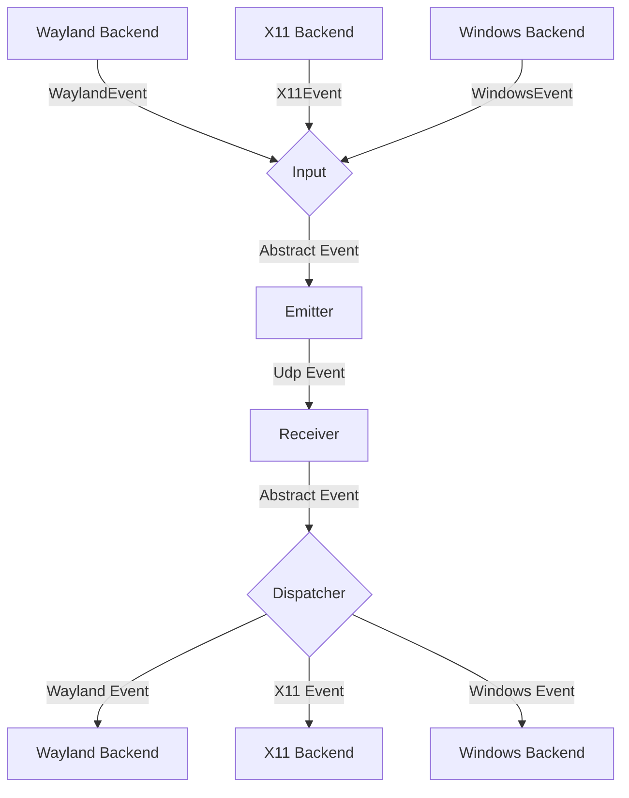
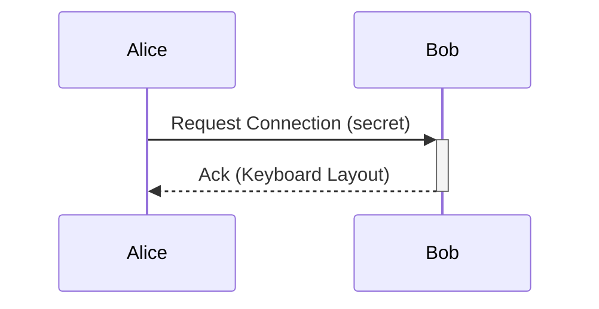

# General Software Architecture

## Events

Each instance of lan-mouse can emit and receive events, where
an event is either a mouse or keyboard event for now.

The general Architecture is shown in the following flow chart:

### Input
The input component is responsible for translating inputs from a given backend
to a standardized format and passing them to the event emitter.

### Emitter
The event emitter serializes events and sends them over the network
to the correct client.

### Receiver
The receiver receives events over the network and deserializes them into
the standardized event format.

### Dispatcher
The dispatcher component takes events from the event receiver and passes them
to the correct backend corresponding to the type of client.

## Requests

// TODO this currently works differently

Aside from events, requests can be sent via a simple protocol.
For this, a simple tcp server is listening on the same port as the udp
event receiver and accepts requests for connecting to a device or to
request the keymap of a device.

## Problems
The general Idea is to have a bidirectional connection by default, meaning
any connected device can not only receive events but also send events back.

This way when connecting e.g. a PC to a Laptop, either device can be used
to control the other.

It needs to be ensured, that whenever a device is controlled the controlled
device does not transmit the events back to the original sender.
Otherwise events are multiplied and either one of the instances crashes.

To keep the implementation of input backends simple this needs to be handled
on the server level.

## Device State - Active and Inactive
To solve this problem, each device can be in exactly two states:

Either events are sent or received.

This ensures that
- a) Events can never result in a feedback loop.
- b) As soon as a virtual input enters another client, lan-mouse will stop receiving events,
which ensures clients can only be controlled directly and not indirectly through other clients.

## Screen Edges and Intervals

A layout is described by edges, and an edge can carry more than one machine. Each
client on an edge owns a **stretch** of it, so the data model needs an interval,
not just a direction:

| field | meaning |
|---|---|
| `ClientConfig::pos` | which edge of this screen the client hangs off |
| `ClientConfig::edge` | the stretch of that edge the pointer leaves through |
| `ClientConfig::peer_edge` | the stretch of the client's facing edge it lands in |

`EdgeRange` (`input-event/src/edge.rs`) is the type. It is stored in **permille**
(`0..=1000`, half-open) rather than as `f64` because `ClientConfig` derives `Eq`
and an `f64` would break it; the config file still writes plain fractions
(`edge = [0.0, 0.6]`), and the conversion is exact in both directions.

### Attribution happens at the crossing point

The daemon no longer asks "which client owns the right edge" - the answer is
ambiguous the moment two clients share one. It asks where the pointer crossed and
gives it to the client whose stretch contains that point
(`src/capture.rs`, `route`). A crossing that matches no stretch reaches nobody and
is logged; that stretch is a wall.

Only the capture task knows the crossing point, so the routing lives there and the
client manager stays ignorant of geometry (`fd46335` removed `client_at`,
`client_at_fraction` and `edges_at`).

### The fraction is remapped, not forwarded

`ProtoEvent::Enter(Position, f64)` already carries a normalized fraction of the
edge, so no protocol change was needed: the sender remaps its own fraction onto
the receiver's stretch before sending it
(`CaptureEntry::peer_fraction`). Three steps, the same as Synergy's
`mapToFraction` → `transform` → `mapToPixel`: pixel + 0.5 into `[0,1]`, interval
onto interval, back out. It is purely proportional and resolution independent, so
two screens of different sizes agree without knowing each other's pixels.

### What the backends can enforce

| backend | behaviour on a stretch nobody owns |
|---|---|
| libei | a real barrier over the owned stretch only - the pointer hits a physical wall |
| layer-shell | a 1 px surface clipped to the owned stretch - the compositor stops the pointer |
| macOS / Windows | the segments are checked when a crossing is reported, so a crossing outside every stretch reads as "switched and bounced back" rather than a wall |

The first two need the stretch at capture-creation time and rebuild the barrier
when it changes; the latter two read it per event.

### A machine is a list of monitors, not one rectangle

A desk has two monitors, one of them turned on its side. Flattening them into one
bounding box - which is what this code did first - makes an edge range mean "the
stretch of the box", and a box around a rotated monitor contains area no screen
covers: the pointer cannot be there, so a bridge drawn over it promises a crossing
that cannot happen.

`input_event::Layout` is a list of `DisplayInfo` - name, offset, panel size,
rotation, enabled. `DisplayInfo::on_screen()` applies the rotation, which is the
rectangle the compositor lays out and the pointer moves in; a 2560x1440 panel
turned 270 degrees occupies 1440x2560 at its offset.

Two rectangles are derived from it and they are not the same thing:

| | what it is | who uses it |
|---|---|---|
| `Layout::bounds()` | the bounding box of the enabled monitors | edge ranges, barriers, the corner radius |
| `Layout::enabled()` | the individual monitors | the arrangement canvas, hit testing |

An edge range is a fraction of the *bounding box*, because that is what a barrier
spans. The canvas draws the *monitors*, because that is what exists.

The layout travels in the existing `PeerInfo` display slot, as one entry per
monitor: `name:x,y:WxH:rotation:enabled`, separated by `;`. That is more than the
32-byte slot holds, which is why the report was already chunked; `parse_screen_size`
still accepts the size-only and `N displays, WxH` forms an older peer sends.

The backends differ in what they can report. The portal (`libei`) and CoreGraphics
both hand back each region *after* rotation, so the rectangle is taken verbatim and
the rotation is recorded as `normal` - reconstructing it from the rectangle would be
a guess. `layer-shell` reads `wl_output`, which reports the size after the
transform, and does the same.

### The screen size comes from the backend, eventually

The canvas draws the local screen to scale with a size the capture backend
reports, and that size is not available when the barriers are registered: the
portal backend's `create` only queues a message, and the session that can answer
`zones` is established afterwards inside the capture task. So the first read
comes back empty.

The capture task therefore polls the backend once a second and publishes the
first answer it gets - unconditionally, because plugging a monitor in changes the
answer without changing which stretch of an edge anybody owns. A read that
returns nothing never overwrites a size that is already known: from inside the
task "the backend has not talked to the compositor yet" and "there are no
screens" look the same, and blanking a working layout is the worse mistake.

The size travels to the peer in the existing `PeerInfo` display slot, as
`"<width>x<height>"`; `parse_screen_size` reads it back out, and also reads the
older `"<n> displays, <w>x<h>"` a peer on an earlier build still sends.

### Non-goals

- **Per-monitor geometry.** A machine's monitors are flattened into one rectangle.
  Synergy 1 and Input Leap do the same; an L-shaped desk cannot be described.
- **Wrapping.** A machine belongs to one edge, so the pointer cannot wrap around a
  corner.
- **Non-reciprocal links.** Both ends describe the same link.
- **`switchNeedsShift` / `switchNeedsControl` / `switchNeedsAlt`.** A Wayland
  client cannot read the modifiers of a pointer it does not own.
- **`switchDelay`.** A barrier reports the crossing, not the dwell, so there is
  nothing to wait for. `switchDoubleTap` is implemented instead, because two
  crossings are observable.

The arrangement canvas draws all of this from the same numbers
(`lan-mouse-gtk/src/arrangement/layout.rs`), so the picture and the routing cannot
disagree: what is drawn as a bridge is what a crossing goes through, and what is
drawn as a wall is where the pointer stops.
